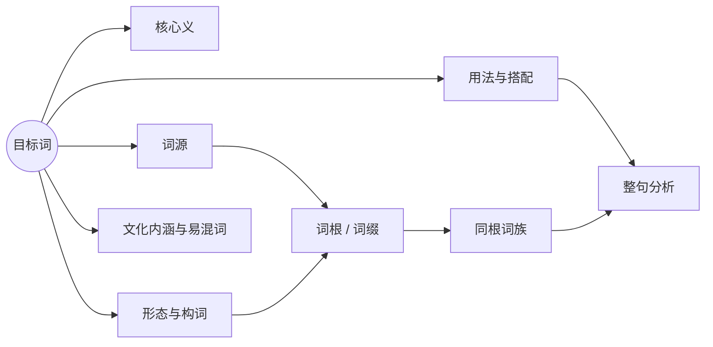

<p align="center">
  
</p>

<h1 align="center">Linguist · 智能辞典</h1>

<p align="center">
  不只告诉你怎么译，更解释一个词为什么是这个意思。
</p>

<p align="center">
  
  
  
</p>

<p align="center">
  <a href="https://pineapplezy.github.io/linguist/"><strong>打开网页版</strong></a>
  ·
  <a href="https://github.com/PineappleZY/linguist/releases/download/v6.5.0/Linguist-6.5.0.apk"><strong>下载 Android 6.5 APK</strong></a>
  ·
  <a href="https://github.com/PineappleZY/linguist/releases/download/v6.5.0/Linguist-6.5.0-portable.exe"><strong>下载 Windows 6.5 版</strong></a>
  ·
  <a href="docs/feature-map/feature-map.html">查看功能知识图谱</a>
</p>

---

## 这是什么

Linguist 是一款以**词根知识图谱**为核心的智能辞典。普通词典通常以“词 → 译义”为中心；Linguist 把一次查询组织成一张可追溯的学习地图：



它不是把更多信息堆在一起，而是让学习者看见词形、意义和历史之间的联系。查完一个词，可以顺势理解它为什么这样构词、哪些词与它同源、在句子里如何使用。

支持英语、法语、德语、日语与中文，并覆盖单词、整句和文件三种阅读尺度。

## 7.0 网页版更新

当前网页版已升级到 **Linguist 7.0.0**：

- **Roots 词根标签**：从查词结果建立词根索引，查看关联词与掌握度。
- **词根复习闭环**：按 10 分钟、1 天、3 天、7 天、21 天、60 天的阶梯安排掌握度，并提供五题混合复习。
- **200 词随机池**：随机查词改为持久词池，降低重复率，并按 80/20 混合常用语言和非在用语。
- **发现词卡**：非词典语言也能显示核心义、例句、读音与词源说明；只进入专用单词本，不混入普通单词本或练习。
- **更顺手的整理**：句子、文件和发现词支持单行删除与 Undo；拼写练习会明确显示语种。

Android APK 与 Windows EXE 仍为 **6.5.0**，尚未包含 7.0 新功能。网页版、PWA 与鸿蒙 NEXT 使用最新 7.0.0。

- [下载 7.0 单文件 HTML](https://github.com/PineappleZY/linguist/releases/download/v7.0.0/linguist_7.0.0.html)
- [下载 7.0 PWA 网站 ZIP](https://github.com/PineappleZY/linguist/releases/download/v7.0.0/Linguist-7.0.0-web.zip)

## 立即使用

### 网页版

打开 **<https://pineapplezy.github.io/linguist/>**，无需安装即可使用。

- Android：在 Chrome 菜单中选择“添加到主屏幕”。
- iPhone / iPad：在 Safari 中点“分享” → “添加到主屏幕”。
- Windows / macOS：在浏览器地址栏右侧选择“安装”。安装后以独立窗口运行，并缓存应用外壳。

### Android APK · 6.5.0

[下载 Linguist 6.5.0 for Android](https://github.com/PineappleZY/linguist/releases/download/v6.5.0/Linguist-6.5.0.apk)

APK 是一个通用 Android WebView 包，支持 Android 6.0 及以上系统，体积约 616 KiB。应用正文、样式和 PDF 工具全部内置，不需要从网络加载界面；模型查询仍需要联网。

1. 下载 `Linguist-6.5.0.apk`。
2. 点击文件安装；如果系统拦截，允许当前文件管理器“安装未知应用”。
3. 从桌面打开 Linguist，在 Profile 中填入自己的 DeepSeek API Key。

APK 使用项目自签名证书，没有 Google Play 的分发背书。后续同签名版本可以直接覆盖升级。

SHA-256：

```text
9706ba8fcd9dedb273ada09bb0efc7f5e3ff82fbbb1db24eee7f4f501e13436b
```

### HarmonyOS / 鸿蒙

鸿蒙设备按系统版本选择安装方式：

- **HarmonyOS NEXT**：不直接运行 Android APK。请使用系统浏览器打开[网页版](https://pineapplezy.github.io/linguist/app/)，再从浏览器菜单中选择“添加到桌面”。安装后从桌面图标进入，数据保存在当前设备。
- **HarmonyOS 4.x 及更早的安卓兼容版本**：可以使用上面的 Android 6.5 APK。安装方法与普通 Android 设备相同，并需要在系统中允许当前文件管理器安装未知应用。

当前没有发布原生 HarmonyOS HAP。网页版在鸿蒙 NEXT 上使用同一套功能和本地存储，但不享有 Android APK 的独立安装包入口。

### Windows 免安装版 · 6.5.0

[下载 Linguist 6.5.0 for Windows x64](https://github.com/PineappleZY/linguist/releases/download/v6.5.0/Linguist-6.5.0-portable.exe)

下载后直接双击运行，不需要安装。程序未做代码签名，Windows 首次运行可能显示 SmartScreen 提示；选择“更多信息 → 仍要运行”即可。

发布页同时提供 SHA-256 校验值：

```text
c74489950f6bb90e258d3d3912cd675f232e49fb472a415c1bab8396413a068d
```

## 第一次使用

1. 在 [DeepSeek 开放平台](https://platform.deepseek.com/) 创建自己的 API Key。
2. 打开 7.0 网页版、Android 6.5、Windows 6.5，或在鸿蒙 NEXT 的浏览器中打开网页版，进入 **Profile / 个人**。
3. 粘贴 Key，点击保存与连接测试。
4. 回到 **Dictionary / 词典**，输入单词、句子，或切换到“文件”读取本地文本、Markdown、字幕、HTML、DOCX、PDF。

每个使用者使用自己的 Key，费用和额度也属于各自账户。应用不提供共享的公共 Key。

## 使用技巧

| 想解决的问题 | 推荐做法 |
| --- | --- |
| 快速判断一段文字是词还是句子 | 保持查询类型为 **Auto** |
| 学习一个陌生词的词根网络 | 先读 **Word DNA**，再看同根词与派生词 |
| 理解一个多义词 | 对照 **Core meaning**、义项例句和词源时间线 |
| 阅读外语长文 | 切到 **File**，先指定原文语言，再开始分析 |
| 复习真正没掌握的单词 | 在 **Starred** 中开始练习，跳过的词会在组末回环 |
| 让长期学习更顺手 | 在 Profile → Cards 中隐藏不需要的卡片并调整顺序 |
| 换一种语言理解词义 | 在词条页切换解释语言，不必重新查找词条 |
| 避免读音泄露 | 练习时先看提示；见过提示后才手动播放语音 |
| 把查过的词根系统复习 | 打开 **Roots**，查看词根掌握度并开始五题复习 |
| 发现不常见的语言 | 使用 **Surprise**；发现词进入专用单词本，不会混入练习 |

## 为什么是知识图谱

Linguist 的“图谱”首先服务于学习者，而不是数据库展示。一次查询会在几个相互关联的层之间建立路径：

- **词源层**：追溯到有据可查的历史阶段，区分“同源”“借入”与“相似但不相关”。
- **形态层**：拆分词根、前缀、后缀，解释构词关系与词族扩展。
- **语义层**：给出核心义、主要义项、语境中的含义和语义演变。
- **使用层**：连接搭配、语体、变位变格、整句结构和文化内涵。
- **学习层**：把历史、星标、词根掌握度和复习连成可回看的个人路径。

开发层面的“应用 → 能力 → 模块”关系另有一张可交互图：[Linguist 功能知识图谱](docs/feature-map/feature-map.html)。

## 数据与隐私

- API Key、历史、星标、单词本和设置只保存在当前浏览器或当前设备中。
- 网页版不会把 API Key 写入 Service Worker 缓存；Android 壳关闭系统自动备份；备份文件也不包含 API Key。
- 查询内容会使用你自己的 Key 发送到 DeepSeek。除完成请求所需外，应用没有自己的中转服务器。
- 网页版、Android 版与 Windows 版数据彼此独立；鸿蒙 NEXT 使用网页版存储。需要迁移时，在 Profile 中导出 JSON，再到另一处导入。
- 模型生成内容可能不完整或有误，词源结论尤其应作为线索而不是学术引证。

## 项目结构

```text
.
├── docs/                  GitHub Pages 落地页与可安装 PWA（含鸿蒙 NEXT）
│   ├── app/               当前网页应用成品
│   └── feature-map/       交互式功能知识图谱
├── 7.0/                   Linguist 7.0 网页源码、测试与构建（本轮唯一交付）
├── 6.0/                   Linguist 6.5 已冻结；其 android 工具链与 6.5 产物保持不动
│   └── android/           Android WebView 壳与 APK 构建脚本
├── 落地/windows/          Electron 桌面壳与打包脚本
├── 1.0 … 5.0/             历史版本快照
├── LICENSE                MIT 开源许可证
└── README.md
```

## 本地开发

网页端零构建依赖：

```powershell
python -m http.server 5173 --directory 7.0/web
```

打开 `http://127.0.0.1:5173`。运行测试与重新生成发布产物：

```powershell
node 7.0/web/tests/smoke.js
node 7.0/tools/build.mjs
node docs/feature-map/build.mjs
```

Windows 桌面端：

```powershell
cd 落地/windows
npm install
node scripts/prepare.mjs
npm run dist
```

Android APK：

```powershell
cd 6.0/android
powershell -ExecutionPolicy Bypass -File .\build.ps1
```

## 已知限制

- 查询与文件分析需要联网；安装后的 PWA 只有静态界面可以离线打开。
- 文件图片、扫描版 PDF 和旧版 `.doc` 暂不支持。扫描版 PDF 没有文字层时无法抽取正文。
- Android 版通过侧载安装，目前不通过 Google Play 发布；系统安全提示属于未上架应用的正常行为。
- Android 与 Windows 当前仍是 6.5.0，不包含 7.0 的 Roots、词池与发现词；最新网页功能以网页版为准。
- HarmonyOS NEXT 目前通过网页版使用，不提供原生 HAP；Android APK 仅适用于仍兼容 Android 应用的鸿蒙版本。
- Windows 版目前为 x64 免安装包，不含自动更新、ARM64 或代码签名。
- Electron 环境通常没有可用的系统语音合成音色，因此桌面版的朗读按钮可能隐藏。

## 开源许可

项目采用 [MIT License](LICENSE)。第三方组件许可见其所在目录中的许可证文件。
