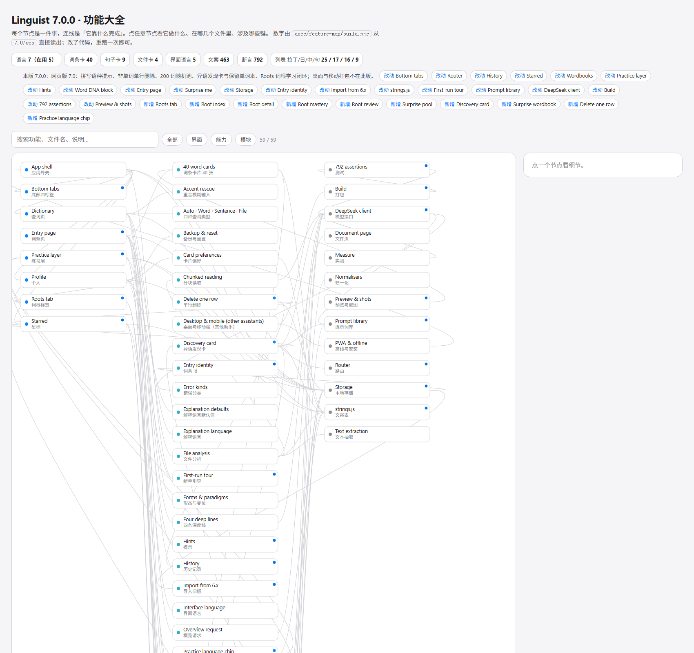
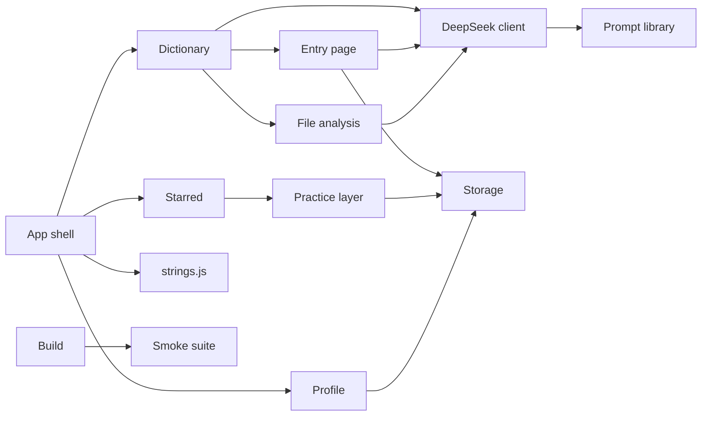

# Linguist 功能大全 · 知识图谱

一张图看清这套应用**有哪些能力、每个能力由哪几个文件实现、依赖什么**。写它的用途很具体：改一个功能之前，先在图里点开它，知道会牵动哪些模块，不必从头读 7.0 的模块源码。

> **这是每次更新的一部分，不是一次性文档。** 流程固定为四步：改功能 → 在 `graph.json` 里加/改对应节点、并在 `changes[]` 顶部写一条当版记录 → 跑 `node docs/feature-map/build.mjs` → 重出截图。版本号改了而图谱没跟上时，**构建与 7.0 的测试套件都会失败**（`features.json` 的版本必须等于 `CONFIG.version`）。

## 怎么看

双击 **`feature-map.html`**（无需服务器、无需联网）。

- 三列分别是**界面 / 能力 / 模块**，点击任意节点，右侧给出它的用途、涉及的文件与键；相关连线会高亮，其余变淡。
- 顶部可按层过滤，或搜功能名、文件名、说明里的词。
- 每个数字（语言数、卡片数、文案条数、断言数）都由 `build.mjs` 从 `7.0/web` 现读，不靠手写。



## 怎么更新

```powershell
node docs/feature-map/build.mjs
```

它会重新读取 `7.0/web/js/config.js`、`strings.js` 与测试文件，合并 `graph.json`（图里所有"人写的"部分：节点、连线、说明），生成 `features.json` 与 `feature-map.html`。改了代码以后重跑一次，数字跟着变。

- `graph.json` — 手工维护：节点、层、说明、文件、键，以及连线。
- `graph.json` 的 `changes[]` — 每个版本一条 `{ version, summary, added, changed }`，新的在前；构建时校验最新一条必须是当前版本、提到的节点必须存在。
- `features.json` — 生成：同样的图，加上从代码读出的数字。
- `viewer.html` — 生成 HTML 的模板（`__PAYLOAD__` 会被替换）。
- `feature-map.html` — 交付物，自包含。

## 四层结构一览



## 找功能时的顺序

| 想知道… | 起点 |
| --- | --- |
| 一次查词经过哪些环节 | `Dictionary` → `Auto · Word · Sentence · File` → `Entry page` → `Four deep lines` → `DeepSeek client` → `Prompt library` |
| 词条页为什么长这样 | `Entry page` → `Word cards` / `Word DNA block` / `Forms & paradigms` |
| 卡片能改顺序吗 | `Profile` → `Card preferences`（适用表在 `config.js` 的 `CARD_LANGS`） |
| 收藏与练习 | `Starred` → `Words / Sentences / Files` → `Practice layer` → `Skip & loop` |
| 文件是怎么读进来的 | `File analysis` → `Text extraction`（pdf.js / DOCX）→ `Chunked reading` |
| 界面语言与解释语言的区别 | `Interface language`（`strings.js`）与 `Explanation defaults`（`languages` × `outputLangBySource`） |
| 数据存在哪、怎么隔离 | `Storage` → `Entry identity` → `Import from 5.x` |
| 改了东西怎么验 | `Build` → `Smoke suite` / `Preview & shots` / `Measure` |
